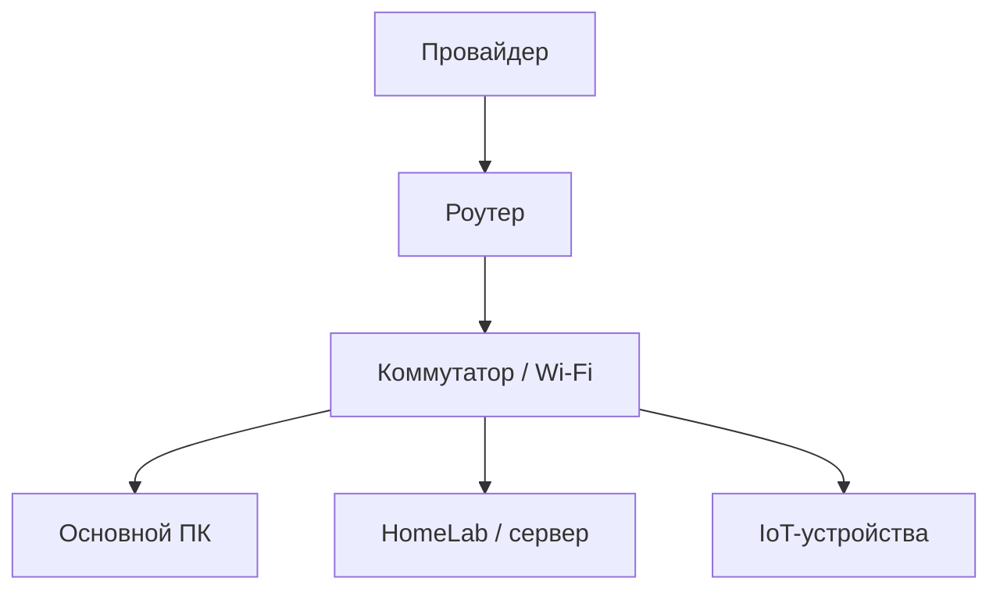

# HomeLab — главный хаб

> [!info] Назначение
> Это корневая карта проекта. Здесь — цели, навигация, текущий фокус, инвентарь и журналы. Детали живут в отдельных заметках по папкам.

## Цель и текущий фокус

- **Глобальная цель:** изучить сети и построить домашнюю лабораторию.
- **Текущий этап:** `база сетей + инвентаризация домашней сети`
- **Следующий шаг:** `настроить первую виртуальную машину / Docker-сервис`
- **Ближайший результат:** `работающий Pi-hole или reverse proxy в lab`

## Навигация

### Теория
- [[Studies/HomeLab/Theory/Моя домашняя сеть]]
- [[Studies/HomeLab/Theory/OSI и TCP-IP]]
- [[Studies/HomeLab/Theory/IP-адресация и подсети]]
- [[Studies/HomeLab/Theory/DHCP]]
- [[Studies/HomeLab/Theory/DNS]]
- [[Studies/HomeLab/Theory/NAT и маршрутизация]]
- [[Studies/HomeLab/Theory/VLAN]]

### Оборудование
- [[Studies/HomeLab/Hardware/Network_Devices/Роутер]]
- [[Studies/HomeLab/Hardware/Network_Devices/Коммутатор]]
- [[Studies/HomeLab/Hardware/Servers/Сервер 1]]
- [[Studies/HomeLab/Hardware/Инвентарь оборудования]]

### Сервисы
- [[Studies/HomeLab/Services/Pi-hole]]
- [[Studies/HomeLab/Services/Docker]]
- [[Studies/HomeLab/Services/Proxmox]]
- [[Studies/HomeLab/Services/Nginx Proxy Manager]]
- [[Studies/HomeLab/Services/Portainer]]

### Лаборатории
- [[Studies/HomeLab/Labs/Лаборатория 01 — Инвентаризация домашней сети]]
- [[Studies/HomeLab/Labs/Лаборатория 02 — Docker и первый контейнер]]
- [[Studies/HomeLab/Labs/Лаборатория 03 — Pi-hole]]
- [[Studies/HomeLab/Labs/Лаборатория 04 — Reverse proxy]]
- [[Studies/HomeLab/Labs/Лаборатория 05 — VLAN]]

### Инциденты
- [[Studies/HomeLab/Incidents/Журнал инцидентов]]

### Дизайн и схемы
- [[Studies/HomeLab/Design/Схема сети]]
- [[Studies/HomeLab/Design/IP-план]]
- [[Studies/HomeLab/Design/VLAN-план]]

## Текущая схема сети



> [!tip]
> Если схема часто меняется — ведите её в Excalidraw и вставьте сюда ссылку: `[[Studies/HomeLab/Design/Схема сети]]`.

## Инвентарь

### Устройства

| Устройство | Роль | IP  | MAC | VLAN | Доступ | Статус | Заметка |
| ---------- | ---- | --- | --- | ---- | ------ | ------ | ------- |
|            |      |     | —   | —    |        |        |         |
|            |      |     | —   | —    |        |        |         |
|            |      |     | —   | —    |        |        |         |

### Сервисы

| Сервис    | Хост | Порт | URL | Тип | Статус | Заметка                 |
| --------- | ---- | ---- | --- | --- | ------ | ----------------------- |
| Pi-hole   |      |      |     |     |        | DNS-фильтрация          |
| Portainer |      |      |     |     |        | управление контейнерами |
| NPM       |      |      |     |     |        | reverse proxy           |

## План обучения

- [ ] **Этап 1. База сетей**
  - [x] IP-адресация и подсети
  - [ ] DHCP
  - [ ] DNS
  - [ ] NAT и маршрутизация
  - [ ] Порты и протоколы
- [ ] **Этап 2. Инвентаризация домашней сети**
  - [ ] Зайти в роутер
  - [ ] Выписать DHCP-leases
  - [ ] Зарисовать текущую схему
  - [ ] Заполнить IP-план
- [ ] **Этап 3. Первая лаборатория**
  - [ ] Установить Docker или Proxmox
  - [ ] Запустить первый контейнер/VM
  - [ ] Задокументировать доступы
- [ ] **Этап 4. Первые сервисы**
  - [ ] Pi-hole
  - [ ] Portainer
  - [ ] Nginx Proxy Manager / Caddy
- [ ] **Этап 5. Сегментация**
  - [ ] Теория VLAN
  - [ ] Управляемый коммутатор
  - [ ] VLAN для lab / IoT / trusted
- [ ] **Этап 6. Эксплуатация**
  - [ ] Бэкапы
  - [ ] Мониторинг
  - [ ] Обновления
  - [ ] Журнал инцидентов

## Журнал лабораторных работ

```dataview
TABLE date AS "Дата", status AS "Статус", result AS "Результат"
FROM "Homelab & Networking/04_Labs"
SORT date DESC
```

## Последние инциденты

```dataview
TABLE date AS "Дата", severity AS "Важность", status AS "Статус"
FROM "Homelab & Networking/05_Incidents"
SORT date DESC
LIMIT 10
```

## Соглашения проекта

### IP-план

| Диапазон / VLAN | Назначение             | Шлюз | DHCP | Заметка |
| --------------- | ---------------------- | ---- | ---- | ------- |
|                 | Основная домашняя сеть |      |      |         |
|                 | HomeLab / серверы      |      |      |         |
|                 | IoT                    |      |      |         |

### Правила
- Имена устройств: `роль-место-номер`, например `srv-lab-01`.
- Статические IP — только для роутера, коммутатора, сервера и сетевых сервисов.
- Каждый новый сервис получает заметку в `03_Services`.
- Каждая проблема и её решение фиксируются в `05_Incidents`.
- Перед изменениями в сети — обновить схему и IP-план.

## Ресурсы

- [ ] Прочитать базовый гайд по IP/DNS/DHCP
- [ ] Пройти лабораторию по Docker
- [ ] Изучить Proxmox VE
- [ ] Разобрать VLAN на управляемом коммутаторе
- [ ] Сделать бэкап конфигураций
